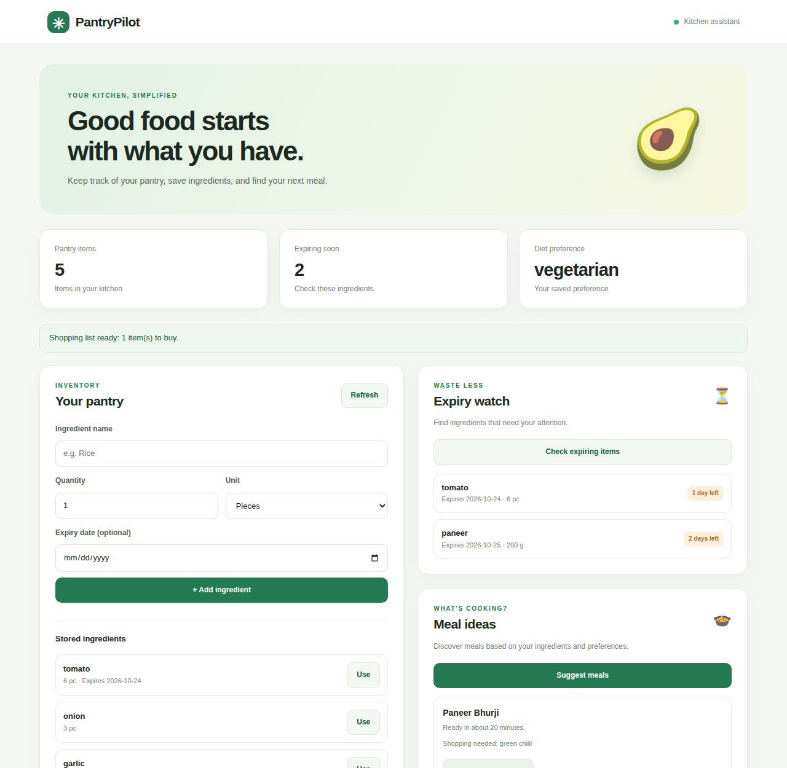

# PantryPilot: a kitchen memory for Alexa+

[](LICENSE)
[](https://www.python.org/)
[](https://modelcontextprotocol.io/)
[](https://amazonappdev2026.devpost.com/)

PantryPilot is a self-hosted **MCP server** (spec **2025-11-25**, **Streamable HTTP**) for the **Alexa+ track**
of the *Build, Ship, Shape: Amazon Developer Hackathon*. It gives Alexa+ a memory that lasts between sessions:
what is in your pantry, what expires soon, and your household's diet and dislikes. It turns that into dinner
suggestions and a shopping list. Pure **Python 3, standard library only**: nothing to install.

> **Track:** Alexa+ (self-hosted MCP server) · **Mini challenge:** Open Source (new MIT-licensed repo)
> **Demo video:** https://youtu.be/rIe9mFX6f8M



*The built-in dashboard talks to the same MCP endpoint Alexa+ uses, so you can try the whole flow without Alexa+ hardware.*

## Table of Contents

- [Features](#features)
- [Try it in 60 seconds](#try-it-in-60-seconds-for-judges)
- [Getting started](#getting-started)
- [Tools](#tools)
- [Architecture](#architecture)
- [Connect to Alexa+](#connect-to-alexa)
- [Configuration](#configuration)
- [Technologies](#technologies)
- [Built during the hackathon](#built-during-the-hackathon)
- [Troubleshooting](#troubleshooting)
- [Contributing](#contributing)
- [Resources](#resources)
- [License](#license)

## Features

- **Persistent kitchen memory**: pantry, expiry dates and household preferences survive restarts and sessions.
- **Waste-aware meal ideas**: recipes are ranked by fewest missing ingredients, with a bonus for using food that is about to expire.
- **Preferences respected**: diet (vegetarian, vegan, eggetarian) and ingredients to avoid always filter the suggestions.
- **One-tap shopping list**: missing ingredients from chosen meals are merged into a single list.
- **Voice-friendly replies**: every tool returns a short spoken sentence plus structured data.
- **Web dashboard**: pantry, expiry watch, meal ideas, shopping list and preferences in one page, no build step.
- **Secure by default**: binds to `127.0.0.1`, rejects unknown browser origins, optional bearer-token auth.

## Try it in 60 seconds (for judges)

```bash
python -m pantrypilot          # then open http://localhost:3000/
```

1. Set a diet preference and save it.
2. Add a few ingredients, one expiring tomorrow.
3. See it appear under **Expiry watch**.
4. Tap **Suggest meals**, then **Add to shopping list**.
5. Stop and restart the server: the pantry and preferences are still there.

## Getting started

### Prerequisites

- **Python 3.10 or newer** (python.org; on Windows tick "Add python.exe to PATH")
- A web browser for the dashboard
- Optional: [cloudflared](https://developers.cloudflare.com/cloudflare-one/connections/connect-networks/downloads/) to expose the server over HTTPS for Alexa+

### Install and run

```bash
git clone https://github.com/prince15975306/pantrypilot
cd pantrypilot
python -m unittest discover -s tests -v    # run the tests
python -m pantrypilot                      # dashboard http://localhost:3000/  MCP http://localhost:3000/mcp
```

On Windows you can use `py` instead of `python`. In VS Code: open the folder, press **Run and Debug**, then choose
"Run PantryPilot server" or "Run tests".

### Quick check from a second terminal

```bash
curl http://localhost:3000/health
curl http://localhost:3000/mcp -H "Content-Type: application/json" -d "{\"jsonrpc\":\"2.0\",\"id\":1,\"method\":\"tools/list\"}"
```

Optional browser end-to-end test of the dashboard:
`pip install playwright && playwright install chromium && python tests/e2e_dashboard.py`

## Tools

| Tool | What it does |
|---|---|
| `add_pantry_item` | Add or top up an item, with an optional expiry date |
| `use_pantry_item` | Reduce quantity after cooking; removes the item when it runs out |
| `list_pantry` | Read out the pantry (and saved preferences) |
| `expiring_soon` | Items expiring within N days |
| `remember_preference` | Persist diet, dislikes, household size |
| `suggest_meals` | Rank recipes by fewest missing items, expiring food first, diet respected |
| `build_shopping_list` | Merge missing ingredients across chosen recipes |

## Architecture

```
 Alexa+ (MCP client) ──┐
                       ├──  POST /mcp  (JSON-RPC 2.0, Streamable HTTP)
 Web dashboard ────────┘            │
                                    ▼
                         pantrypilot/server.py   protocol, auth, origin checks, static files
                                    │
                                    ▼
                         pantrypilot/tools.py    the seven tools
                            │              │
                            ▼              ▼
              planner.py + recipes.py     store.py ──► data/state.json
              (ranking logic)             (persistence)
```

```
.
├── pantrypilot/
│   ├── server.py      MCP server (initialize, tools/list, tools/call, ping) + dashboard hosting
│   ├── tools.py       tool definitions and handlers
│   ├── planner.py     recipe ranking: missing items, expiry bonus, diet and dislikes
│   ├── recipes.py     built-in recipe book
│   └── store.py       JSON-file persistence
├── web/               dashboard (index.html, app.js, style.css)
├── tests/             unit tests + optional browser end-to-end test
├── docs/              screenshot, Devpost text, product feedback template
└── data/              runtime state (state.json is git-ignored)
```

## Connect to Alexa+

Alexa+ needs a public HTTPS URL. Deploy to any host you like, or tunnel the local server for a demo:

```bash
cloudflared tunnel --url http://localhost:3000
```

Then register `https://<your-host>/mcp` by following the Alexa+ MCP documentation (see [Resources](#resources)).
Note: the dashboard is served on the same host and anyone with the URL can change the pantry, so close the
tunnel when you are not demoing.

## Configuration

| Env var | Purpose |
|---|---|
| `PORT` | Port (default 3000) |
| `HOST` | Bind address (default 127.0.0.1) |
| `MCP_BEARER_TOKEN` | If set, MCP requests need `Authorization: Bearer <token>` |
| `ALLOWED_ORIGINS` | Extra browser origins allowed besides same-origin (default: none) |
| `PANTRY_DB` | Path of the state file |

## Technologies

| Technology | Purpose |
|---|---|
| Python 3.10+ (standard library only) | Server, tools, persistence, tests |
| Model Context Protocol 2025-11-25 | Tool interface for Alexa+ and other MCP clients |
| Streamable HTTP + JSON-RPC 2.0 | Transport |
| HTML, CSS, vanilla JavaScript | Dashboard (no framework, no build step) |
| Playwright (optional) | Browser end-to-end test |

## Built during the hackathon

Everything in this repository (MCP server, tools, recipe ranking, persistence, dashboard and tests) was created
during the submission period.

## Troubleshooting

**`python` is not recognized (Windows).** Try `py` instead. If that fails, reinstall Python from python.org and tick
"Add python.exe to PATH", then open a new terminal.

**"Running scripts is disabled on this system" (PowerShell).** You do not need npm or any script for this project.
Use `python -m pantrypilot`. If another tool is blocked, `Set-ExecutionPolicy -Scope CurrentUser RemoteSigned` fixes it.

**Port 3000 is already in use.** An old server is still running. Stop it with Ctrl+C, or choose another port:
`set PORT=3001` (PowerShell: `$env:PORT="3001"`), then start again.

**The dashboard says it cannot connect.** Make sure the server terminal is still running and that you opened
`http://localhost:3000/` in a browser rather than opening `index.html` from disk.

**The tunnel URL stopped working.** Free quick tunnels get a new address each time cloudflared restarts and have
no uptime guarantee. Re-register the new `/mcp` URL.

**Tests fail with an import error.** Run them from the repository root so `pantrypilot` can be imported.

## Contributing

Contributions are welcome. See [CONTRIBUTING.md](CONTRIBUTING.md). For questions or ideas, open an issue.

## Resources

- [Model Context Protocol docs](https://modelcontextprotocol.io/docs/latest/getting-started/intro)
- [Hackathon page on Devpost](https://amazonappdev2026.devpost.com/)
- [Amazon Developer: Alexa+](https://developer.amazon.com/) (follow the Alexa+ MCP documentation from the hackathon page)

## License

MIT. See [LICENSE](LICENSE).
